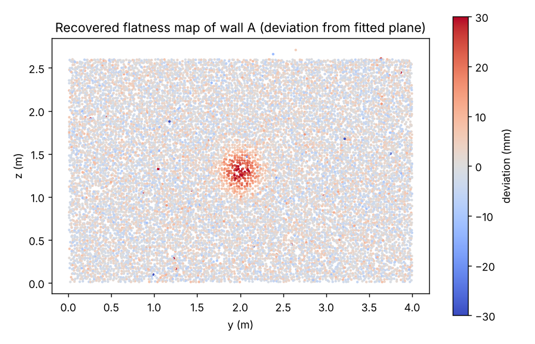
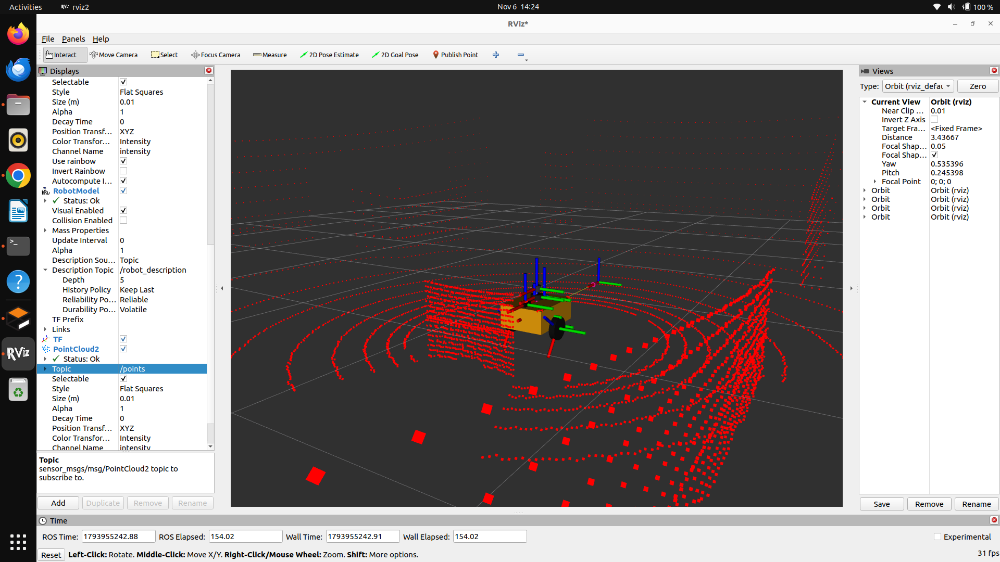
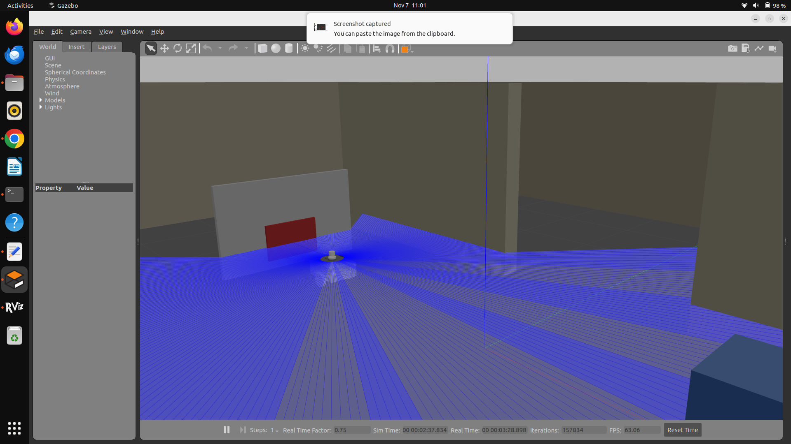

# pointcloud-plane-flatness

Planar-surface extraction and flatness analysis for 3D point clouds, written **from scratch in C++17**
(no PCL, no Open3D, no Eigen), with a **ROS 2** node and a **Gazebo** test rig.

Given a noisy point cloud from a LiDAR or depth sensor, it finds the dominant planes (floor, walls, ceiling),
fits them accurately, and measures how far each surface deviates from flat, so a bump or dent shows up as a colour map.


*Synthetic room: a planted 30 mm bump on the wall is recovered at the right location (red). Colour = deviation from the fitted plane.*

## What is implemented (all from scratch)

| Stage | File | Algorithm |
|---|---|---|
| Downsampling | `include/planeperc/voxel_grid.hpp` | hash-grid centroid per voxel, O(n) |
| Neighbour search | `kdtree.hpp` | k-d tree (median split on widest axis), kNN with a bounded max-heap |
| Denoising | `outlier_removal.hpp` | statistical outlier removal (mean k-NN distance, mean + k·σ threshold) |
| Plane detection | `ransac_plane.hpp` | RANSAC with adaptive iteration count, least-squares refinement, sequential multi-plane extraction |
| Plane fitting | `plane_fit.hpp` | covariance matrix + Jacobi eigen-solver (smallest eigenvector = normal) |
| Flatness | `flatness.hpp` | in-plane grid of per-cell **median** deviations: robust to outliers |
| Pipeline | `pipeline.hpp` | end-to-end with per-stage timing; offset measurement between near-parallel planes (e.g. a raised patch in front of a wall) |

Background and derivations: [`docs/UNDERSTANDING.md`](docs/UNDERSTANDING.md).

## Repository layout

```
include/planeperc/   header-only core library
apps/                synthetic_eval.cpp   (accuracy + parameter sweep against ground truth)
                     lidar_panel_sim.cpp  (ray-cast simulation of the rover LiDAR looking at a panel with a 30 mm patch)
tests/               unit_tests.cpp      (k-d tree vs brute force, Jacobi, RANSAC with outliers, ...)
ros/                 plane_node.cpp      (ROS 2 wrapper)
gazebo/              rover URDF (3D LiDAR + IMU) and a test world
scripts/             fake_room_publisher.py  (synthetic PointCloud2 stream for testing without Gazebo)
docs/                results, figures, explanation of every algorithm
.github/workflows/   CI: build + unit tests + evaluation smoke test
```

## Build and test (no ROS needed)

```bash
sudo apt install -y build-essential cmake
cmake -S . -B build && cmake --build build -j
ctest --test-dir build --output-on-failure
./build/synthetic_eval build        # accuracy + sweep -> build/sweep.csv, build/flatness_wall.ply
```

## Results on synthetic data (known ground truth)

Scene: 5 × 4 × 2.6 m room, 3000 points/m², 4 mm Gaussian depth noise, 3 % random outliers,
and a 30 mm Gaussian bump (σ = 15 cm) on one wall. Default parameters: voxel 30 mm, RANSAC threshold 10 mm.
Full output: [`docs/eval_output.txt`](docs/eval_output.txt), sweep table: [`docs/sweep_results.csv`](docs/sweep_results.csv).
Reproduce with `./build/synthetic_eval build`; exact numbers vary slightly with compiler and CPU.

* Plane normal error **0.001–0.006°**, offset error **< 0.2 mm** for all three planes
* Planted 30 mm bump measured as **about +31 mm**; flat surfaces show a ±7 mm noise floor, so a 30 mm feature is clearly detectable
* About 550 ms per frame for 134k raw points on one CPU core (statistical outlier removal dominates)

What the parameter sweep shows:

* A RANSAC threshold below ~2.5× the sensor noise fragments planes into extra detections;
  a threshold far above the noise still finds the planes but inflates the bump estimate.
* Larger voxels are much faster but average away small features (100 mm voxels measured the bump as 25 mm instead of 30 mm).

## Run on ROS 2

Tested on Ubuntu with ROS 2 Humble and Gazebo Classic.

```bash
mkdir -p ~/ws/src && cp -r planeperc ~/ws/src/ && cd ~/ws
colcon build --packages-select planeperc && source install/setup.bash

# Node: subscribes to "points" (sensor_msgs/PointCloud2), publishes "flatness_cloud" (XYZRGB, colour = deviation)
ros2 run planeperc plane_node --ros-args -r points:=/points -p ransac_threshold:=0.02
```

Parameters: `voxel_leaf`, `ransac_threshold`, `max_planes`, `sor_k`, `sor_std`, `flat_band`, `flat_cell`, `deviation_range`.

Without a simulator, stream a synthetic room instead:

```bash
python3 scripts/fake_room_publisher.py      # publishes /points at 2 Hz
```

In RViz: Fixed Frame = sensor frame, add PointCloud2 on `/flatness_cloud`, Color Transformer = `RGB8`.

## Gazebo test rig

`gazebo/rover_urdf_3d_lidar_imu.xacro` is a differential-drive rover with extra sensors added for this project:

* a **3D LiDAR** (CPU ray sensor, 360 × 16 rays, 5 mm Gaussian noise) publishing `sensor_msgs/PointCloud2` on `/points`
* an **IMU** sensor plugin (100 Hz, Gaussian noise) publishing `sensor_msgs/Imu` on `/imu/data`

`gazebo/flatness_test.world` is a minimal world with a floor, a wall and a 30 mm raised patch. It is provided for
testing the flatness measurement and is not used for the numbers reported above.


*3D LiDAR cloud from the Gazebo rover, visualised in RViz.*



**Gazebo result.** The rover faces a test panel (1.6 × 1.0 m) with a 30 mm raised patch, placed in the construction-site world.
On the 3D LiDAR cloud (5,393 points per frame, about 4,850 after outlier removal) the node finds 6 planes in 23–53 ms per frame.

* Plane distances agree with the world geometry. The partition (1.401 m), south wall (4.899 m) and material stack (2.605 m)
  place the sensor at the same y position to within 6 mm, and the floor plane is 0.309 m from the sensor.
* The 30 mm patch is detected as its own plane in front of the panel. The two planes are 29 mm and 28 mm apart in
  two consecutive frames (patch 0.813 m / 0.811 m, panel 0.842 m / 0.839 m from the sensor), and both planes place the
  sensor at the same x position to within 2 mm.

Example node output (one frame; plane normals are in the sensor frame, `d` is the distance from the sensor):

```
6 planes found
  plane 0: n=(0.000 -0.001 1.000) d=0.309 m | inliers=1960 (40%) | flat rms=4.9 mm
  plane 1: n=(-0.001 -1.000 0.001) d=1.401 m | inliers=947 (20%) | flat rms=5.7 mm
  plane 2: n=(0.999 0.032 -0.008) d=0.813 m | inliers=883 (18%) | flat rms=10.6 mm
  plane 3: n=(1.000 0.005 0.002) d=0.842 m | inliers=388 (8%) | flat rms=6.5 mm
  plane 4: n=(0.001 1.000 -0.001) d=4.899 m | inliers=226 (5%) | flat rms=4.9 mm
  plane 5: n=(-0.005 1.000 -0.002) d=2.605 m | inliers=176 (4%) | flat rms=4.7 mm
in=5393 clean=4849 | SOR 19.9 ms, RANSAC 1.9 ms, flatness 0.8 ms, total 22.7 ms
```

Flatness is read on the wall and panel planes: the floor plane's flatness band also contains the bases of nearby objects,
which inflates its peak value.

Notes from setting this up:

* With the new sensors added, the controller manager failed to start with a parser error on `robot_description`.
  Removing the XML comments from the URDF fixed it, so the URDF in this repo has no comments.
* A Gazebo depth camera crashed `gzserver` with a rendering assertion on my laptop, so I used a CPU ray-sensor point cloud instead.

## LiDAR simulation check: measuring a 30 mm step

`apps/lidar_panel_sim.cpp` ray-casts the rover's LiDAR (360 × 16 rays, 5 mm range noise) against a panel with a 30 mm raised
patch, the same geometry as the Gazebo test, so the measurement can be checked against known truth. Over 20 noisy frames:

| RANSAC threshold | frames with patch + panel found | tilt between the two planes | step from plane distances | step from `parallelOffsets` |
|---|---|---|---|---|
| 20 mm (2/3 of the step) | 20 / 20 | 4.3° | 29.5 ± 12.9 mm | 23.4 ± 4.2 mm |
| 12 mm (2.4 σ of the noise) | 20 / 20 | 0.5° | 29.4 ± 1.3 mm | 28.0 ± 3.6 mm |

A threshold close to the step size makes the patch plane absorb panel points and tilt; a threshold of about 2.5 σ of the sensor
noise keeps the planes separate. Run it with `./build/lidar_panel_sim` (numbers vary slightly with compiler and CPU).

## Limitations

* Quantitative accuracy claims come from **synthetic** data. The Gazebo LiDAR cloud is sparse (16 rings), so plane estimates
  there are coarser; it demonstrates the pipeline end to end.
* Real sensors have range-dependent noise, occlusions and calibration error that the synthetic scene does not model.
* Statistical outlier removal is the speed bottleneck (single-threaded). Skipping it or lowering `k` is the first optimisation.
* Sequential RANSAC can merge two coplanar but disconnected surfaces; there is no connected-component check yet.

## Roadmap

* Point-to-plane ICP between frames and an EKF that tracks plane parameters using IMU / odometry
* Real-sensor evaluation (depth camera or recorded rosbag)
* Multi-threaded neighbour search; semantic segmentation of surface defects

## License

MIT, see [LICENSE](LICENSE).

## Author

Parinitha P Rao ([GitHub](https://github.com/raoparinitha03), [LinkedIn](https://www.linkedin.com/in/parinitha-p-rao-82abb9227/))
